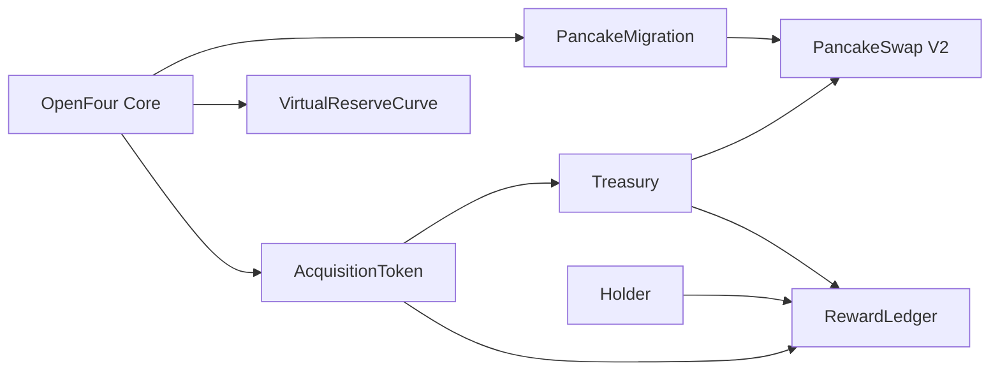

# Contract architecture

The fixed PI token and configurable HoldPI preset use the same transfer, reward, treasury, pricing and migration implementations. Policy adapters preserve their initialization tuples, descriptors and external function signatures.

| Component | Responsibility |
| --- | --- |
| `common/AcquisitionToken.sol` | Transfer classification, acquisition debits and credits, canonical-pool registration and treasury burns |
| `common/RewardLedger.sol` | Bounded daily cohorts, mature indices, funded distributions and holder claims |
| `common/Treasury.sol` | Measured WBNB receipts, disjoint budgets, oracle observations and permissionless processing |
| `common/VirtualReserveCurve.sol` | Bonding quotes and terminal-price arithmetic |
| `common/PancakeMigration.sol` | Canonical liquidity seeding, inventory checks and locked LP |
| `Pi*.sol` | Fixed PI policy and platform descriptors |
| `protocol/Hold*.sol` | Initialization-bound policy tables, preset validation and encoding schemas |
| `protocol/HoldConfig.sol` | The configuration tuple and supported policy bounds |

## Acquisition accounting

The token debits the sender's newest acquisitions first and credits received tokens at a fresh conservative day boundary. Self-transfers and zero transfers preserve age. The ledger holds at most 31 active daily cohorts per account and globally. Mature holdings share one reward index.

PI uses two integer weight units for 1x loyalty. The configurable adapter uses 10,000 units for 1x. Distribution normalizes the entire funded pot by total weight, so both default policies produce equivalent payouts. Adapter-specific weight units remain visible through the existing getters and distribution event.

The token transfer path calls the bound ledger and reads the treasury's processing flag. DEX conversion and recipient payout execute through dedicated treasury and claim methods. Bonding settlement relies on the bound Core collecting the trader's tokens directly into the vault. That caller and ordering assumption is part of the platform integration review.

## Backing and budgets

Treasury allocations derive from cumulative WBNB actually received. Holder, burn, liquidity and operations budgets each track allocated and spent amounts. Spending reduces the corresponding available balance and accounted backing. Integer rounding leaves residual WBNB backed in the treasury.

Reward funding records the received balance delta. Distribution assigns eligible cohort indices and carries scaled rounding forward. Claiming settles the caller, consumes whole-wei credit, then transfers WBNB or unwraps it. A rejected native payment falls back to WBNB. A reverted payout restores transaction state.

## Trust and deployment

Token policy is fixed during initialization. The platform's Core, registry bindings and beacon upgrade governance remain external dependencies. The operations address controls only its allocated operations balance. Anyone may call eligible treasury processing and reward settlement at their own gas cost.

The shared-contract refactor targets fresh deployments. Internal storage layout and bytecode differ from the original review snapshot. Any upgrade proposal needs an explicit storage-layout and deployment review.

## Regression coverage

The shared contract suite runs all default-policy cases against both variants. It covers acquisition boundaries, transfer taxation, normalized rewards, claim failures and reentrancy, budget isolation, bounded cohorts, randomized accounting, two-year dormancy, real DEX swaps, treasury execution and migration. Separate configuration tests exercise policy encoding, custom curves, cadence, minimum funding and validator rejection paths.

The independent Python and browser models provide additional checks on rates, weights and conservation. Source-bound receipts and deterministic archives connect executed tests to exported code. The platform acceptance work is tracked in the integration document. [OpenFour integration](OPENFOUR.md)
